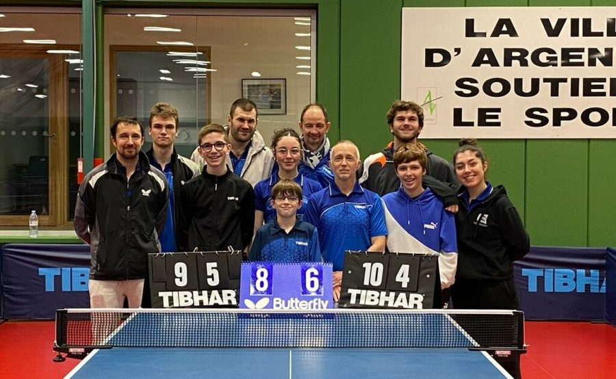

<!--
  arBATT - Table tennis club referee companion (PWA)

  Free software developed by Franck LEFEVRE for K1 ( https://k1info.com ),
  with the help of his team of kind and playful robots.
  Please use the enormous power of this software to do good things for things
  and people, always making sure it harms nothing and no one.
-->

<p align="center">
  <br/>
  <strong>L'arbitre de club de tennis de table, dans ta poche.</strong><br/>
  <em>PWA · 100 % hors-ligne · installable en scannant un QR code · zéro pub, zéro pisteur</em>
</p>

# arBATT — l'assistant de l'arbitre de club de tennis de table

> **Tu arbitres une partie au club ?** arBATT compte les points à ta place —
> **en simple comme en double** — et gère pour toi le **service**, les **camps**,
> l'**égalité**, les **temps morts**, les **cartons**, le **chrono de manche** et
> la **règle d'accélération**. Il te souffle même, à chaque étape, *ce que tu ne
> dois pas oublier*. Tu n'as plus qu'à suivre le jeu et taper sur la bonne carte. 🏓

**arBATT** est une **PWA** (Progressive Web App) qui accompagne un·e arbitre de
club de tennis de table pendant ses parties. Elle est pensée pour être ouverte
instantanément en scannant un simple **QR code**, puis utilisée d'une seule main
à la table de marque, y compris **hors-ligne** une fois installée.

Développé par et pour le **BATT — Bayard Argentan Tennis de Table**
( [batt.club](https://batt.club/) ), et **offert à tous les clubs** : c'est un
logiciel **libre**, fais-en bon usage ! L'appli démarre sur un **menu**
proposant plusieurs activités, la principale étant le **comptage des points**,
qui applique les règles du *Manuel pratique d'arbitre de club* de la FFTT
(édition 2025/2026, fourni dans `doc/`).

> En toutes circonstances… **RESTEZ SPORT !**

---

## Sommaire

- [Fonctionnalités](#fonctionnalités)
- [Architecture du projet](#architecture-du-projet)
- [Installation](#installation)
- [Démarrage du serveur](#démarrage-du-serveur)
- [Déploiement](#déploiement)
- [Utilisation](#utilisation)
- [Mode scoreboard / OBS & feuille de match](#mode-scoreboard--obs--feuille-de-match)
- [Règles de comptage implémentées](#règles-de-comptage-implémentées)
- [Paramètres de configuration](#paramètres-de-configuration)
- [Formats de fichiers](#formats-de-fichiers)
- [Journalisation (logs)](#journalisation-logs)
- [Tests](#tests)
- [Feuille de route](#feuille-de-route)
- [Licence](#licence)

---

## Fonctionnalités

- 📱 **PWA installable** (manifest + service worker) utilisable **hors-ligne**.
- 🏓 **Comptage des points en simple ET en double** : score, manches, service,
  camps, égalité (deuce), temps morts, annulation (undo), annonce du score.
  En double : rotation des 4 serveurs/relanceurs, désignation du service à
  chaque manche, inversion des relanceurs à 5 points en manche décisive.
- ⏱️ **Chronomètres** : période d'adaptation (2 min) et temps mort (1 min),
  avec anneau de progression, bip et vibration en fin de décompte.
- ⏩ **Règle d'accélération** : service à chaque point + compteur de 13 renvois
  (le serveur perd le point au 13e renvoi du relanceur).
- 🟨 **Cartons & sanctions** : échelle jaune → jaune+rouge (+1) → jaune+rouge
  (+2) → rouge (juge-arbitre), avec points de pénalité attribués à l'adversaire.
- ⏲️ **Chronométrie des manches** : horloge de manche (10 min) sur le tableau de
  marque, qui **déclenche automatiquement** l'accélération à la limite si moins
  de 18 points ont été marqués. **Repos d'1 min automatisé** entre les manches.
- 🧾 **Résumé des manches** : les scores des manches déjà jouées (ex. « 11-4 ·
  9-11 ») s'affichent sur la page de score, à côté du nombre de manches.
- 📺 **Mode scoreboard / OBS** : un affichage public (`scoreboard.html`, fond
  transparent 1920×1080) à **superposer à la vidéo dans OBS**, mis à jour **en
  direct** pendant que l'arbitre continue de saisir sur son téléphone : score,
  service, manches, balles de manche/match, cartons, compte à rebours (temps
  mort, repos), accélération, et **animations** (point marqué, manche gagnée,
  victoire avec confettis, carton, accélération).
- 🗒️ **Feuille de match** : préparez les rencontres d'une journée par équipes
  (simples et doubles, génération « chacun contre chacun »), arbitrez-les une à
  une (▶), les **résultats s'inscrivent automatiquement** et le **score
  d'équipe** est visible dans l'appli **et** à l'écran. Export / import JSON.
- 🦇 Aux couleurs du club : logo **BATT-Man** (Bayard Argentan Tennis de Table).
- 📋 **Déroulé de la partie** : les étapes d'une partie dans l'ordre, chacune
  avec un encadré « À ce stade je ne dois pas oublier ».
- 📖 **Aide-mémoire** des règles clés directement dans l'app.
- 🦇 **Mieux connaître BATT** : page de présentation du club (sections, salle,
  contact, liens) avec un brin d'humour.
- 🔒 **Serveur web minimal en Python** servant un **unique répertoire**
  (`www/`) de façon **hermétique** (aucun accès hors de ce répertoire).
- ⚙️ Tout est **paramétrable** (port, en-tête `Server`, web-root, logs…), via
  fichiers JSON **et** variables d'environnement.

## Architecture du projet

```
arBATT/
├── server.py               # Serveur web statique minimal et hermétique
├── arbatt_config.py        # Configuration (JSON + env) + générateur UNIQUE de app-config.json
├── arbatt_log.py           # Journalisation centralisée (routage unique)
├── arbatt_live.py          # Relais temps réel du mode scoreboard (/api/live/)
├── config/
│   ├── param.json(.example)    # Paramètres non confidentiels
│   └── secret.json(.example)   # Paramètres confidentiels (git-ignoré)
├── www/                    # ★ UNIQUE répertoire servi (web-root)
│   ├── index.html              # Menu + écrans (setup, score, fin, règles, déroulé)
│   ├── manifest.webmanifest    # Manifest PWA
│   ├── sw.js                   # Service worker (offline)
│   ├── .htaccess               # Types MIME Apache (déploiement statique)
│   ├── app-config.json         # Version + durées (livré ; régénéré par le serveur)
│   ├── css/style.css
│   ├── js/log.js               # Logger client (routage unique)
│   ├── js/timer.js             # Moteur de compte à rebours (chronos)
│   ├── js/scorer.js            # Moteur de comptage SIMPLE (machine à états)
│   ├── js/doubles.js           # Moteur de comptage DOUBLE (machine à états)
│   ├── js/app.js               # Contrôleur d'interface (2 modes)
│   ├── js/sheet.js             # Modèle de la feuille de match (pur)
│   ├── js/live.js              # Lien temps réel arbitre ↔ affichage public
│   ├── js/studio.js            # Régie : écran feuille de match + panneau Diffusion
│   ├── scoreboard.html         # ★ Affichage public / overlay OBS
│   ├── api/live.php            # Relais temps réel en PHP (hébergement statique)
│   ├── api/.htaccess           # Réécriture Apache api/live/… -> live.php
│   ├── css/scoreboard.css      # Habillage de l'overlay (1920×1080, transparent)
│   ├── js/scoreboard.js        # Rendu + animations de l'overlay
│   └── icons/                  # Icônes PWA (svg + png 192/512/maskable)
├── dynamic/                # Données personnalisées (git-ignoré)
├── logs/                   # Tous les fichiers de logs (git-ignoré)
├── deploy/                 # Déploiement statique
│   ├── INSTALL.md              # Guide (WordPress, statique, SSH/git, QR)
│   └── update.sh               # Mise à jour one-command (git pull + copie)
├── package.json            # Scripts npm + dépendance de dev jsdom
├── tests/                  # Tests headless (Node)
│   ├── run_all.js              # Lance toutes les suites (npm test)
│   ├── test_scorer.js          # Moteur simple
│   ├── test_timer.js           # Chronomètres
│   ├── test_doubles.js         # Moteur double
│   ├── test_acceleration.js    # Règle d'accélération
│   ├── test_sanctions.js       # Cartons & sanctions
│   ├── test_chrono.js          # Chronométrie + accélération auto
│   ├── dom_harness.js          # Harnais jsdom partagé
│   ├── test_ui_dom.js          # Intégration UI (jsdom)
│   ├── test_sheet.js           # Modèle de feuille de match + snapshot live
│   ├── test_live_dom.js        # Bout en bout arbitre ↔ overlay (jsdom)
│   ├── test_live_relay.py      # Relais HTTP/SSE : Python ET PHP, mêmes tests
│   ├── php_live_router.php     # Routeur de test pour `php -S` (simule .htaccess)
│   ├── test_app_config.py      # Générateur de app-config.json + fichier livré à jour
│   ├── test_config_error_dom.js # app-config.json absent/invalide : erreur visible, actions bloquées
│   └── check_offline_chrome.py # Vérif. manuelle : PWA hors-ligne dans un vrai Chrome
└── doc/manuel AC.pdf       # Manuel officiel de référence
```

## Installation

**Pré-requis :** Python ≥ 3.8 (testé avec 3.12). Aucune dépendance externe pour
faire tourner le serveur. (PIL/Pillow n'est utilisé qu'une fois pour générer les
icônes ; les icônes générées sont déjà incluses.)

```bash
# 1. Récupérer le projet
cd arBATT

# 2. Préparer la configuration
cp config/param.json.example  config/param.json     # déjà présent par défaut
cp config/secret.json.example config/secret.json    # déjà présent par défaut
#   puis éditez config/param.json selon vos besoins (port, etc.)
```

## Démarrage du serveur

```bash
python3 server.py
```

Au démarrage, le serveur **affiche le numéro de version** (tag `[BOOT]`), purge
le fichier d'erreurs `logs/server.err.txt`, génère `www/app-config.json` depuis
`config/param.json`, puis écoute sur `http://HOST:PORT/`.

Par défaut : <http://0.0.0.0:8080/>.

Vous pouvez tout surcharger par variable d'environnement, par exemple :

```bash
ARBATT_PORT=8099 ARBATT_SERVER_HEADER="ma-salle" python3 server.py
```

> 💡 Le serveur Python n'est **nécessaire qu'en développement**. Pour la mise à
> disposition publique, voir [Déploiement](#déploiement).

## Déploiement

arBATT est une **PWA 100 % statique** : pour la publier, il suffit de servir le
dossier **`www/`** en **HTTPS** par n'importe quel serveur web. Le cas le plus
courant — **déposer le dossier dans un sous-répertoire d'un site WordPress
existant** — ainsi que les sous-domaines, l'hébergement statique pur (GitHub
Pages, Netlify…), les types MIME, le service worker et le QR code, sont
détaillés pas à pas dans **[`deploy/INSTALL.md`](deploy/INSTALL.md)**.

En bref :

```bash
# (optionnel) régénérer www/app-config.json depuis config/param.json
python3 server.py   # écrit le fichier, puis Ctrl-C
# puis téléverser le contenu de www/ dans, p.ex., https://mon-club.fr/arbatt/
```

- `www/app-config.json` est **livré avec l'appli** (lu tel quel en statique).
- `www/.htaccess` règle les types MIME sur Apache (ignoré ailleurs).
- HTTPS est **obligatoire** pour le service worker (installation + hors-ligne).

**Mise à jour par git en SSH** (si vous avez un accès SSH au serveur) : clonez
le dépôt hors du web et liez `www/` au dossier public, puis une seule commande
suffit pour mettre à jour :

```bash
# installation (une fois)
cd ~ && git clone https://github.com/francklefevre/arBATT.git arbatt-src
ln -s ~/arbatt-src/www ~/www/arbatt          # appli sur https://SITE/arbatt/
# mise à jour
cd ~/arbatt-src && git pull
```

(Variante sans symlink via `deploy/update.sh` : voir `deploy/INSTALL.md`.)

## Utilisation

> **Essai rapide en local** : `python3 server.py` puis ouvrez
> <http://localhost:8080/> (sur ce PC) ou `http://<IP-du-PC>:8080/` (téléphone
> sur le même Wi-Fi). Overlay de démonstration :
> <http://localhost:8080/scoreboard.html?demo=sheet>.
> Hors-ligne : le service worker ne s'installe qu'en **HTTPS** ou sur
> **localhost** (pas sur `http://<IP>`).

1. Ouvrez l'URL (ou scannez le QR code) sur un smartphone.
2. *(facultatif)* « **Installer l'application** » depuis le menu du navigateur
   pour l'usage hors-ligne et plein écran.
3. Menu → **Comptage des points** → renseignez les joueurs, le **format**
   (manches gagnantes, points par manche) et le **tirage au sort** (premier
   serveur et côté gauche au départ), puis **Démarrer**.
4. Sur le tableau de marque :
   - **Touchez la carte d'un joueur** pour lui attribuer le point.
   - La carte au **service** est encadrée en jaune ; le sens de jeu
     (Gauche/Droite) est rappelé en bas de chaque carte.
   - L'**annonce** (serveur d'abord) s'affiche sous le tableau.
   - Boutons : **Annuler** (undo), **Temps mort A/B** (1 par joueur), **Menu**.
   - Indices contextuels : **essuyage** (tous les 6 points), **égalité** à 10-10.
5. À la fin, l'écran récapitule le score et le détail des manches.

Le menu propose aussi la **Période d'adaptation** (chrono 2 min), le **Déroulé
de la partie** (étapes + rappels « À ce stade je ne dois pas oublier »), un
**Aide-mémoire** des règles, et **Mieux connaître BATT** (présentation du club).

## Mode scoreboard / OBS & feuille de match

### Principe

L'arbitre garde **son écran de saisie habituel**. Chaque action (point,
annulation, carton, temps mort, repos, accélération…) publie un **instantané
complet** de la partie vers un **affichage public** : la page
**`scoreboard.html`**, conçue comme **Source navigateur OBS** (1920×1080, **fond
transparent**) à superposer à la vidéo. Le public voit le score, les animations
et, à la demande, la feuille de match ; l'affichage n'accepte aucune saisie.

```
 Téléphone de l'arbitre                  relais                 PC de diffusion (OBS)
 ┌──────────────────────┐   POST    ┌────────────────┐   SSE   ┌──────────────────────┐
 │ arBATT (index.html)  │ ────────▶ │ server.py  OU  │ ──────▶ │ Source navigateur :  │
 │ saisie des points    │           │ api/live.php   │         │ scoreboard.html?ch=… │
 └──────────────────────┘           │ /api/live/…    │         └──────────────────────┘
                                    └────────────────┘
        └──────── BroadcastChannel (même navigateur, même appareil) ─────────┘
```

Deux transports fonctionnent **en même temps** (ils sont complémentaires) :

| Transport | Quand | Remarques |
|-----------|-------|-----------|
| **Relais HTTP — PHP** (`www/api/live.php`, *v0.1.13*) | L'appli est en ligne sur un hébergement **Apache + PHP** (OVH, WordPress… : p. ex. `https://batt.club/arbatt/`) | Arbitre et OBS **n'importe où**, via Internet. Rien à lancer : livré avec `www/`. |
| **Relais HTTP — Python** (`server.py`) | L'appli est servie par `python3 server.py` (p. ex. sur le PC OBS, le téléphone s'y connecte en Wi-Fi) | Arbitre et OBS sur **des appareils différents**, **sans Internet** (réseau local). |
| **BroadcastChannel** | Appli et affichage dans **le même navigateur** (deux onglets/fenêtres) | Marche partout. Dans OBS, utilisez alors une **Capture de fenêtre** (avec `?bg=00b140` + filtre Chroma key). |

Les deux relais exposent **exactement la même API** (`/api/live/…`) ; l'appli
détecte celui qui est présent (`GET api/live/_info`). S'il n'y en a aucun
(hébergement purement statique sans PHP, GitHub Pages…), le panneau *Diffusion*
l'indique (« indisponible sur cet hébergement »).

**Particularités du relais PHP** (contraintes de l'hébergement mutualisé) :
le dernier instantané de chaque canal est un **fichier** (dossier
`ARBATT_LIVE_PHP_DATA_DIR`, par défaut le dossier temporaire du système, hors
du web) ; une réponse SSE dure au plus `ARBATT_LIVE_PHP_STREAM_SECONDS` (25 s)
puis le navigateur se **reconnecte tout seul** (≈ 1 s, sans renvoi grâce à
`Last-Event-ID`) ; chaque overlay ouvert occupe **un processus PHP** en
permanence — sans souci pour quelques sources OBS, à surveiller au-delà.

### Mise en place avec l'appli en ligne (relais PHP)

1. Sur le **téléphone de l'arbitre**, ouvrez l'appli en ligne (p. ex.
   `https://batt.club/arbatt/`) → **📺 Diffusion / OBS** : « relais actif ✓ ».
2. Copiez l'**adresse de l'affichage public** et collez-la dans OBS comme
   **Source navigateur** 1920×1080 (voir étape 3 ci-dessous).
3. Si l'appli est publique, **protégez la publication** par un jeton
   (`ARBATT_LIVE_TOKEN`, voir `deploy/INSTALL.md`) et saisissez-le dans le
   panneau *Diffusion* du téléphone.

### Mise en place sans Internet (relais Python sur le PC OBS)

1. Sur le **PC de diffusion**, lancez le serveur : `python3 server.py`
   (port `8080` par défaut ; notez l'adresse IP locale du PC, p. ex. `192.168.1.20`).
2. Sur le **téléphone de l'arbitre** (même Wi-Fi), ouvrez
   `http://192.168.1.20:8080/` → menu **📺 Diffusion / OBS** : l'état du relais
   doit indiquer « **actif ✓** ». Copiez l'**adresse de l'affichage public**
   (`…/scoreboard.html?ch=<uuid>`).
3. Dans **OBS** : *Sources* → **+** → **Navigateur** → URL = l'adresse copiée
   (en remplaçant l'IP par `localhost` si OBS tourne sur ce PC), **largeur 1920,
   hauteur 1080**. Le fond est transparent : placez la source au-dessus de la
   caméra.
4. Arbitrez normalement : l'overlay suit en direct.

> Le canal est un **UUID** propre à chaque téléphone (mémorisé). Le bouton
> **🔀 Nouveau canal** en génère un autre (l'ancienne adresse cesse alors de
> recevoir). Pour plusieurs tables, chaque arbitre a son propre canal : une
> source OBS par table.

### Ce que montre l'affichage public

- **Bandeau de score** : noms (paire en double), point de service animé, scores
  des manches jouées, manches gagnées, points de la manche, cartons (🟨/🟥),
  « **BALLE DE MANCHE** » / « **BALLE DE MATCH** », contexte (manche n,
  décisive, rencontre n/N, score d'équipe).
- **Pastilles** : compte à rebours **temps mort / repos / adaptation**
  (décompté localement), **⏩ accélération** avec le compteur de renvois.
- **Bannières animées** : présentation de la rencontre, manche gagnée, carton
  (avec la pénalité), règle d'accélération, temps mort, **victoire** (avec
  confettis). Elles sont déduites des **différences** entre deux instantanés :
  une annulation ne déclenche jamais de célébration, et un affichage qui se
  reconnecte ne rejoue rien.
- **Feuille de match** plein panneau (case « Afficher la feuille de match à
  l'écran » du panneau *Diffusion*), rencontre en cours surlignée.

Le panneau **📺 Diffusion** (menu, tableau de marque, feuille de match) permet de
copier/ouvrir l'adresse, de choisir ce qui est affiché (score / feuille), de
saisir le **jeton** si le relais est protégé et de changer de canal.

### Paramètres d'URL de `scoreboard.html`

| Paramètre | Défaut | Rôle |
|-----------|--------|------|
| `ch` | *(obligatoire)* | Canal (fourni par le panneau *Diffusion*). |
| `pos` | `bl` | Coin du bandeau : `bl`, `br`, `tl`, `tr` ou `bc` (bas centre). |
| `scale` | `1` | Facteur de taille du bandeau (p. ex. `1.3`). |
| `bg` | transparent | Couleur de fond, p. ex. `00b140` pour une incrustation (chroma key). |
| `relay` | `1` | `relay=0` : n'écoute que le BroadcastChannel (même navigateur). |
| `demo` | — | `demo=1` : partie fictive animée pour **positionner l'overlay** dans OBS sans arbitre ; `demo=sheet` ajoute la feuille. |

Hors OBS, la page affiche un message d'aide (« en attente de l'arbitre » /
« connecté ») ; **dans OBS ce message n'apparaît jamais**.

### Feuille de match

Menu → **🗒️ Feuille de match** :

1. Saisissez le **titre** et le nom des **deux équipes**.
2. Ajoutez les rencontres : **➕ Ajouter** (simple, ou double avec
   « Nom 1 / Nom 2 » de chaque côté) ou **⚡ Générer depuis les compositions**
   (chaque joueur de A contre chaque joueur de B, par tours de rotation, +
   N doubles) puis **supprimez / réordonnez** (↑ ↓ ✕) pour coller à la feuille
   officielle.
3. **▶** sur une rencontre (ou **▶ Arbitrer la prochaine rencontre**) ouvre le
   formulaire de partie **pré-rempli** ; l'équipe A est toujours à gauche
   (côté 0). À la fin de la partie, le **résultat** (manches + scores) est
   **inscrit automatiquement** et le **score d'équipe** mis à jour ; l'écran de
   fin propose de revenir à la feuille. **↺** efface un résultat.
4. **⬇️ Exporter / ⬆️ Importer** : la feuille est un fichier JSON (préparez-la à
   l'avance sur un autre appareil). **🆕 Nouvelle feuille** demande une double
   confirmation.

La feuille et les réglages de diffusion sont conservés **sur l'appareil**
(stockage du navigateur, clés `arbatt.sheet.v1` et `arbatt.live.v1`) : pensez
à **exporter** la feuille pour la garder.

## Règles de comptage implémentées

Conformément au manuel FFTT (voir `doc/`), en **simple** :

- Manche gagnée à **11 points** avec **2 points d'écart** minimum.
- À **10-10** (égalité), le jeu continue jusqu'à **2 points d'écart**.
- Le **service change tous les 2 points** ; à partir de **10-10**, il change à
  **chaque point**.
- Le **premier serveur alterne** à chaque manche.
- **Changement de camp** à chaque manche ; dans la **manche décisive**, on
  change de camp dès qu'un joueur atteint **5 points**.
- Le score est **annoncé serveur en premier**, puis relanceur.
- **1 temps mort** par joueur et par partie.
- **Essuyage** signalé tous les **6 points**.

Le serveur et les camps sont **dérivés du score** : l'annulation (undo) restitue
donc toujours un état exact.

### En double

- Le service va en **diagonale** ; le **serveur change tous les 2 points**, le
  relanceur devenant alors serveur (rotation des **4 joueurs**).
- La paire qui sert **désigne son serveur** au début de chaque manche ; arBATT
  ouvre automatiquement un sélecteur de désignation (corrigeable via 🔁 Service).
- Dans la **manche décisive**, à **5 points** : changement de camp **et**
  **inversion de l'ordre des relanceurs**.
- **1 temps mort par paire** et par partie.

### Chronomètres

- **Période d'adaptation** : 2 min (depuis le menu ou l'écran de préparation).
- **Temps mort** : 1 min (déclenché par les boutons « Temps mort »).
- Anneau de progression, alerte sous 10 s, **bip** et **vibration** à la fin.
- Durées **paramétrables** (voir `ARBATT_WARMUP_SECONDS` / `ARBATT_TIMEOUT_SECONDS`).

### Règle d'accélération

- Activée par l'arbitre (bouton **⏩ Accélération**) ; **une fois active, elle le
  reste** jusqu'à la fin de la partie.
- Le **serveur change à chaque point** (le moteur le gère automatiquement, même
  si la règle est activée en cours de manche).
- Un **compteur de renvois** apparaît : à chaque renvoi du relanceur, l'arbitre
  appuie sur **+1 renvoi** ; au **13e** (paramétrable), le point est attribué au
  **relanceur** et le compteur est remis à zéro. Un point « normal » (tap sur la
  carte) remet aussi le compteur à zéro.

> Le déclenchement automatique (10 min de jeu, < 18 points) sera branché quand
> la chronométrie des manches sera ajoutée ; en attendant, l'activation est
> manuelle, ce qui est réglementaire (« à la demande des 2 joueurs »).

### Chronométrie, repos & accélération automatique

Le tableau de marque affiche une **horloge de manche** (comptage croissant) avec
un bouton pause/reprise. Quand elle atteint **`ARBATT_GAME_MINUTES`** (10 min) et
que moins de **`ARBATT_ACCEL_POINTS_THRESHOLD`** (18) points ont été marqués dans
la manche, la **règle d'accélération s'active automatiquement** (bip + vibration).
L'horloge se réinitialise à chaque manche et se met en pause pendant les
chronos de temps mort / période d'adaptation.

À la **fin de chaque manche** (sauf la dernière), un **repos d'1 minute**
(`ARBATT_REST_SECONDS`) s'ouvre **automatiquement** ; en double, la désignation
du service de la manche suivante est proposée **après** ce repos. Les **scores
des manches déjà jouées** sont résumés en haut du tableau (le score gagnant en
surbrillance).

### Cartons & sanctions

Depuis le tableau de marque, bouton **🟨 Carton** → choisir le joueur fautif.
L'échelle (manuel p.13) est appliquée automatiquement :

| Faute | Carton(s) | Pénalité |
|------:|-----------|----------|
| 1re   | 🟨 jaune | aucun point |
| 2e    | 🟨🟥 jaune + rouge | **+1 point** à l'adversaire |
| 3e    | 🟨🟥 jaune + rouge | **+2 points** à l'adversaire |
| 4e    | 🟥 rouge | **recours au juge-arbitre** (partie perdue par pénalité) |

Les cartons accumulés sont affichés sur chaque carte. En double, le compte est
**par joueur** et les points de pénalité vont à la **paire adverse**. L'undo
annule une sanction (carton **et** point de pénalité). En cas d'erreur, le
bouton **« − Retirer »** (dans l'overlay de sanction) enlève le dernier carton
d'un joueur et **réannule le point de pénalité** correspondant.

*Non encore couvert (voir [Feuille de route](#feuille-de-route))* : la
chronométrie des manches.

## Paramètres de configuration

Tous les paramètres vivent dans `config/param.json` (non confidentiel) et
`config/secret.json` (confidentiel, git-ignoré). **Chaque paramètre peut être
surchargé par une variable d'environnement portant le même nom.** L'ordre de
priorité est : `param.json` → `secret.json` → variable d'environnement.

| Paramètre                | Type    | Défaut        | Description |
|--------------------------|---------|---------------|-------------|
| `version`                | string  | `0.1.0`       | Version `x.y.z` affichée au démarrage et dans la PWA. |
| `ARBATT_HOST`            | string  | `0.0.0.0`     | Interface d'écoute du serveur. |
| `ARBATT_PORT`            | int     | `8080`        | Port d'écoute. |
| `ARBATT_WEBROOT`         | string  | `www`         | **Unique** répertoire servi (hermétique). |
| `ARBATT_SERVER_HEADER`   | string  | `arBATT`      | Valeur renvoyée dans l'en-tête HTTP `Server`. |
| `ARBATT_DEFAULT_DOCUMENT`| string  | `index.html`  | Document servi pour un répertoire. |
| `ARBATT_WARMUP_SECONDS`  | int     | `120`         | Durée du chrono de période d'adaptation (s). |
| `ARBATT_TIMEOUT_SECONDS` | int     | `60`          | Durée du chrono de temps mort (s). |
| `ARBATT_REST_SECONDS`    | int     | `60`          | Durée du repos automatique entre les manches (s). |
| `ARBATT_ACCEL_RETURNS`   | int     | `13`          | Nombre de renvois du relanceur donnant le point (règle d'accélération). |
| `ARBATT_GAME_MINUTES`    | int     | `10`          | Durée de manche (min) avant déclenchement de l'accélération. |
| `ARBATT_ACCEL_POINTS_THRESHOLD` | int | `18`       | Seuil de points sous lequel l'accélération se déclenche à la limite de temps. |
| `ARBATT_APP_CONFIG_KEYS` | object  | voir fichier  | **Seule** liste de ce que reçoit la PWA dans `www/app-config.json` : `{"cléClient": "NOM_DU_PARAMÈTRE"}` (+ `version`, toujours incluse). Pour exposer un nouveau paramètre à l'appli, ajoutez-le ici **et** déclarez son type dans `APP_CONFIG_TYPES` (`www/js/app.js`). |
| `ARBATT_LIVE_RELAY`      | bool    | `true`        | Active le relais temps réel du mode scoreboard (`/api/live/`). `false` : le serveur répond 404 comme un hébergement statique. |
| `ARBATT_LIVE_MAX_BYTES`  | int     | `65536`       | Taille max. d'un instantané publié (octets) ; au-delà : HTTP 413. |
| `ARBATT_LIVE_MAX_CHANNELS` | int   | `50`          | Nombre max. de canaux gardés en mémoire ; le moins récemment mis à jour est évincé. |
| `ARBATT_LIVE_KEEPALIVE_SECONDS` | int | `15`       | Intervalle des commentaires *keep-alive* des flux SSE inactifs (s). |
| `ARBATT_LIVE_PHP_DATA_DIR` | string | *(vide)*     | Relais PHP : dossier des instantanés (un fichier par canal). Vide = `<dossier temporaire du système>/arbatt-live`. Relatif = par rapport à la racine du dépôt. **Ne pas** le placer dans `www/`. |
| `ARBATT_LIVE_PHP_STREAM_SECONDS` | int | `25`     | Relais PHP : durée max. d'une réponse SSE avant reconnexion automatique (rester sous la limite d'exécution de l'hébergeur). |
| `ARBATT_LIVE_PHP_POLL_MS` | int    | `250`         | Relais PHP : intervalle de lecture du fichier du canal pendant un flux SSE (ms). |
| `ARBATT_LIVE_PHP_TIMEZONE` | string | `Europe/Paris` | Relais PHP : fuseau des horodatages de `live_php.log` (PHP est en UTC par défaut). |
| `ARBATT_LOG_DIR`         | string  | `logs`        | Répertoire de tous les fichiers de logs. |
| `ARBATT_LOG_TO_CONSOLE`  | bool    | `true`        | Écho des logs activés sur la console. |
| `ARBATT_LOG_TO_FILE`     | bool    | `true`        | Écriture des logs dans `logs/server.log`. |
| `ARBATT_LOG_TAGS`        | object  | voir fichier  | Active/désactive chaque catégorie de log (`BOOT`, `CONFIG`, `HTTP`, `SECURITY`, `LIVE`, `ERROR`, `WARN`, `INFO`, `DEBUG`). |
| `ARBATT_LIVE_TOKEN`      | string  | *(vide)*      | *(secret)* Jeton exigé (en-tête `X-Arbatt-Token`) pour **publier** sur le relais ; vide = relais ouvert. La lecture (overlay) reste libre. L'arbitre le saisit dans le panneau *Diffusion*. |
| `ARBATT_ADMIN_TOKEN`     | string  | *(vide)*      | *(secret, réservé pour un usage futur)* |

> **Relais PHP** : il lit les mêmes `param.json` / `secret.json` (dans
> `ARBATT_CONFIG_DIR`, par défaut `www/api/../../config`, c.-à-d. le dépôt) et
> les mêmes variables d'environnement, y compris celles posées par `SetEnv`
> dans un `.htaccess` (lues aussi dans `$_SERVER` et sous le nom
> `REDIRECT_<nom>`, cas de PHP-FPM derrière une réécriture). `ARBATT_CONFIG_DIR`
> ne se règle que par l'environnement.

> Pour surcharger un paramètre objet comme `ARBATT_LOG_TAGS` via l'environnement,
> fournissez une valeur **JSON** : `ARBATT_LOG_TAGS='{"DEBUG":true}'`.

## Formats de fichiers

- **`config/*.json`** — objets JSON. Les clés commençant par `_` sont purement
  documentaires (notice de licence, description) et sont ignorées au chargement.
- **`www/app-config.json`** — `{"version", "warmupSeconds", "timeoutSeconds",
  "restSeconds", "accelReturns", "gameMinutes", "accelPointsThreshold"}`
  (clés définies par `ARBATT_APP_CONFIG_KEYS`), **généré** par un **unique**
  constructeur (`arbatt_config.build_app_config`) : au démarrage de
  `server.py`, par `deploy/update.sh`, ou à la main :
  `python3 arbatt_config.py --write` (écrit `www/app-config.json`) /
  `python3 arbatt_config.py --print` (affiche le JSON). Ce fichier est
  **versionné** (servi tel quel par l'hébergement statique) : un test vérifie
  qu'il est à jour — régénérez-le après chaque changement de `param.json`.
  **L'appli n'a aucune valeur par défaut** (depuis v0.1.15) : si ce fichier est
  absent, illisible ou s'il lui manque une clé (ou qu'une clé a un mauvais
  type), un bandeau rouge l'indique en haut de l'écran, la version affiche
  `v?`, et le démarrage d'une partie ou de la période d'adaptation est
  bloqué (logs `[ERROR] #2002` / `#2009` / `#2010`). Une clé inconnue de
  l'appli ne donne qu'un `[WARN] #2008`.
- **Feuille de match (export/import, `arbatt-feuille-AAAA-MM-JJ.json`)** :
  ```json
  { "format": "arbatt-sheet", "v": 1, "id": "<uuid>",
    "title": "Régionale 2 — J4", "teams": ["BATT", "Flers"],
    "encounters": [
      { "id": "<uuid>", "kind": "singles", "sides": [["Claire"], ["Denis"]],
        "result": { "winner": 0, "games": [3, 1],
                    "scores": [[11, 5], [9, 11], [11, 7], [11, 8]] } },
      { "id": "<uuid>", "kind": "doubles",
        "sides": [["Claire", "Emma"], ["Denis", "Fabien"]], "result": null } ] }
  ```
  `winner` / `games` / `scores` sont vus depuis l'équipe A (côté 0).
- **Instantané live** (protocole 1, publié par l'arbitre, reçu par l'overlay) :
  `{protocol, channel, pub, seq, sentAt, version, display:{scorebug, sheet},
  match, timer, sheet}` — `match` est construit par `matchSnapshot()`
  (`www/js/live.js`) : `matchId, mode, names[], sides[2], points, games,
  gameIndex, bestOf, pointsPerGame, isDeciding, finished, winner, servingSide,
  server, receiver, leftSide, infractions[], refereeCalled, accelerated,
  returnCount, accelReturns, timeoutsUsed, completedGames, encounterId` ;
  `timer` = `{label, totalMs, remainingMs, running, finished}` ou `null` ;
  `sheet` = feuille avec libellés et score d'équipe pré-calculés. `pub` (UUID
  par chargement de l'appli) + `seq` permettent à l'overlay d'ignorer les
  doublons (même instantané reçu par les deux transports).
- **API du relais** (`server.py`) :
  `GET /api/live/_info` → `{"relay":true,"tokenRequired":bool}` ;
  `POST /api/live/<canal>` (corps = instantané JSON, en-tête `X-Arbatt-Token`
  si configuré) → `{"seq":n}` ; `GET /api/live/<canal>` → dernier instantané ;
  `GET /api/live/<canal>/events` → flux **SSE** (dernier instantané immédiat,
  puis chaque nouveau ; l'en-tête `Last-Event-ID` évite de renvoyer un
  instantané déjà reçu). Canal : `[A-Za-z0-9_-]{1,64}`. Relais Python : rien
  n'est écrit sur disque (mémoire). Relais PHP : un fichier
  `<canal>.live` par canal (ligne 1 = n° de séquence, ligne 2 = JSON compact),
  remplacé atomiquement ; les réponses SSE se terminent après
  `ARBATT_LIVE_PHP_STREAM_SECONDS` (`retry: 1000`).
- **`logs/live_php.log` / `logs/live_php.err.txt`** — logs du relais PHP, même
  format `STAMP [TAG] #66NN message` (dans le dépôt si `config/` est trouvé,
  sinon sous `ARBATT_LIVE_PHP_DATA_DIR/logs`). Chaque requête PHP étant un
  « programme » éphémère, le fichier d'erreurs n'est **pas** vidé à chaque
  requête : supprimez-le à la main pour le remettre à zéro.
- **`logs/server.log`** — une ligne par événement :
  `STAMP [TAG] #NNNN message` (voir ci-dessous).
- **`logs/server.err.txt`** — mêmes lignes mais limitées aux `ERROR`/`WARN` ;
  **vidé à chaque démarrage**.

## Journalisation (logs)

Toute information loggée (serveur **et** PWA) passe par une **fonction de routage
unique**. Chaque ligne est préfixée par :

```
2026-06-02T16:12:34.015 [HTTP] #1004 200 /js/scorer.js (10247 bytes, ...)
└─ horodatage          └ tag  └ n°évt └ message
```

- Le **tag** (`[HTTP]`, `[BOOT]`, `[SECURITY]`…) décrit la nature de
  l'information ; il peut être **activé/désactivé** dynamiquement via
  `ARBATT_LOG_TAGS`.
- Le **numéro d'événement** (`#NNNN`) identifie le point d'émission dans le code
  (convention : `1xxx` serveur, `2xxx` app PWA, `3xxx` moteur de comptage,
  `4xxx` chronos, `5xxx` double, `6xxx` hub du relais (`arbatt_live.py`),
  `66xx` relais PHP (`www/api/live.php`),
  `7xxx` feuille de match, `80xx` lien live, `85xx` overlay, `9xxx` régie).
- Tous les fichiers de logs sont dans `logs/`. Les erreurs sont en plus
  recopiées dans `<programme>.err.txt`.

Côté PWA, le logger est accessible depuis la console du navigateur
(`arbattLog(tag, eid, msg)`, configuration live dans `ARBATT_LOG`).

## Tests

Toute la suite de tests (Node.js) :

```bash
npm test                      # lance les 12 suites et affiche un résumé
# ou individuellement :
node tests/test_scorer.js        # simple
node tests/test_timer.js         # chronomètres (horloge simulée)
node tests/test_doubles.js       # double
node tests/test_acceleration.js  # règle d'accélération
node tests/test_sanctions.js     # cartons & sanctions
node tests/test_chrono.js        # chronométrie + accélération auto
node tests/test_ui_dom.js        # intégration UI (jsdom)
node tests/test_sheet.js         # feuille de match + instantané live
node tests/test_live_dom.js      # bout en bout arbitre ↔ overlay (jsdom)
python3 tests/test_live_relay.py # relais HTTP/SSE : Python puis PHP (php -S)
python3 tests/test_app_config.py # générateur de app-config.json (+ fichier livré à jour)
node tests/test_config_error_dom.js # app-config.json absent/invalide -> erreur visible
```

Vérification **hors-ligne** dans un **vrai Chrome** (manuelle, hors `npm test`
car elle demande Google Chrome / Chromium) :

```bash
npm run check:offline     # = python3 tests/check_offline_chrome.py
```

Elle lance `server.py` et un Chrome headless, laisse le service worker
s'installer, **arrête le serveur**, puis recharge et vérifie que tout marche
depuis le cache : version, saisie de points, feuille de match, overlay.
```

Pré-requis pour `test_ui_dom.js` : **jsdom** (dépendance de dev). Installez les
dépendances une fois avec `npm install`.

Ils couvrent : l'alternance du service, l'égalité (deuce), la fin de
manche/partie, l'alternance du premier serveur, les changements de camp (dont à
5 points en manche décisive), l'annulation, les temps morts, la rotation des 4
joueurs en double (vérifiée contre l'exemple du manuel), l'inversion des
relanceurs en manche décisive, le compte à rebours (pause/reprise, bornes), la
règle d'accélération (service à chaque point, persistance, compteur de 13
renvois), et le **câblage de l'interface** de bout en bout (navigation, saisie
des points, mode simple/double, désignation du service, panneau d'accélération),
et le **mode scoreboard** : feuille de match (ajout, génération, validation,
persistance, résultats), affichage public piloté en direct par l'appli
(noms, points, service, cartons, balles de manche/match, repos, vainqueur,
score d'équipe), publication vers le relais, et le relais HTTP/SSE lui-même
(validation, jeton, éviction, relais désactivé, reconnexion `Last-Event-ID`)
— **la même suite est jouée contre le relais Python et le relais PHP** (via
`php -S` et `tests/php_live_router.php` ; partie PHP indiquée `SKIP` si `php`
est absent).

## Feuille de route

- [x] Comptage en **double** (rotation, désignation, inversion à 5 en décisive).
- [x] **Chronomètres** : période d'adaptation (2 min) et temps mort (1 min).
- [x] **Règle d'accélération** (service à chaque point, compteur de 13 renvois).
- [x] **Cartons & sanctions** (jaune, jaune+rouge, pénalités de points).
- [x] **Chronométrie des manches** (10 min) + déclenchement **automatique** de
      l'accélération.
- [x] **Repos entre manches** (1 min) automatisé + **résumé des manches** jouées.
- [x] **Mode scoreboard / OBS** (overlay animé en direct) + **feuille de match**
      par équipes avec score d'équipe.
- [x] Relais temps réel **sur l'hébergement statique** (PHP) pour diffuser sans
      `server.py`.
- [ ] **Sauvegarde** des parties dans `dynamic/`.
- [ ] Génération du **QR code** de mise à disposition.

## Le club — BATT 🦇

<p align="center">
  
</p>

**Bayard Argentan Tennis de Table** — 33 rue du Paty, 61200 Argentan. Plus de
**25 ans** de ping pour *tout le monde* : du **baby-ping** à l'**équipe Pro**,
des **valides** et des **para** qui visent les **Jeux**, du **loisir** à la
**compétition** à tous les niveaux. Bref, on est un peu cool. 😎
→ [batt.club](https://batt.club/) · l'appli en ligne : <https://batt.club/arbatt/>

## Licence

Logiciel **libre** : vous pouvez en faire ce que vous voulez. Développé par
**Franck LEFEVRE** pour la société **K1** ( <https://k1info.com> ), aidé de son
équipe de robots gentils et amusants. Utilisez l'énorme puissance de ce logiciel
pour faire des choses **bonnes** pour les choses et les gens, en vous assurant
toujours qu'il ne nuit à rien ni à personne.
